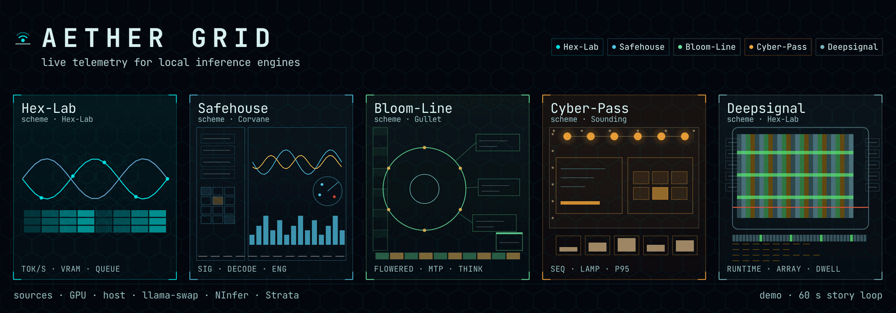
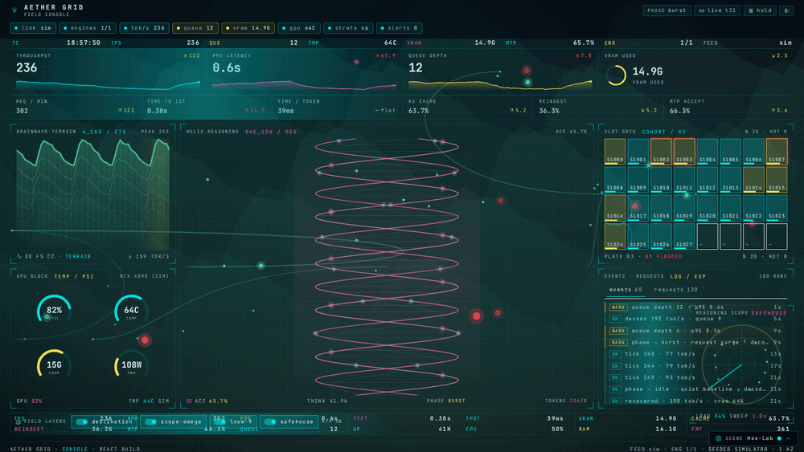
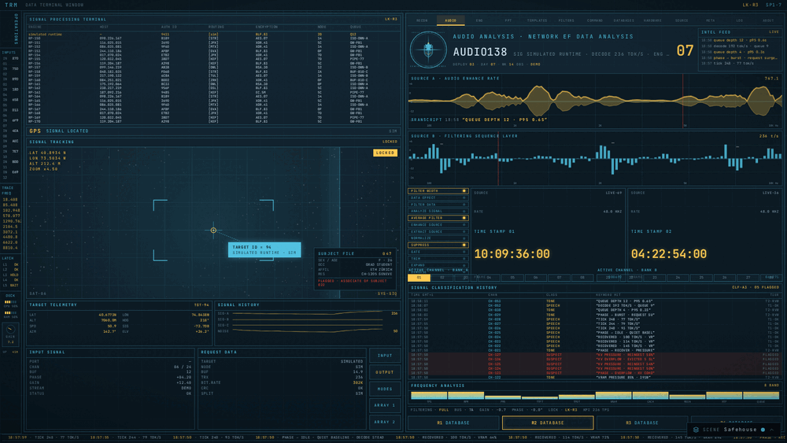
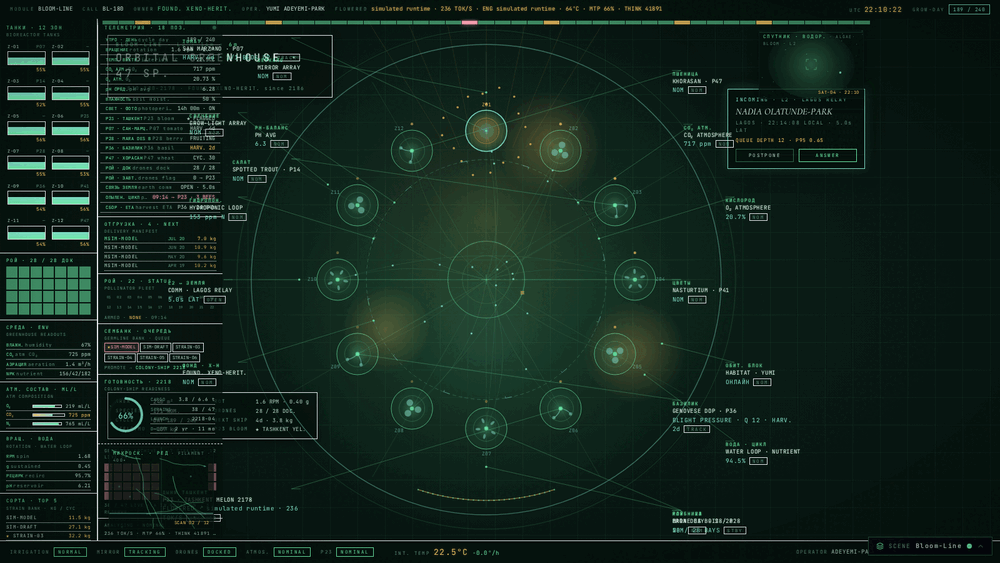
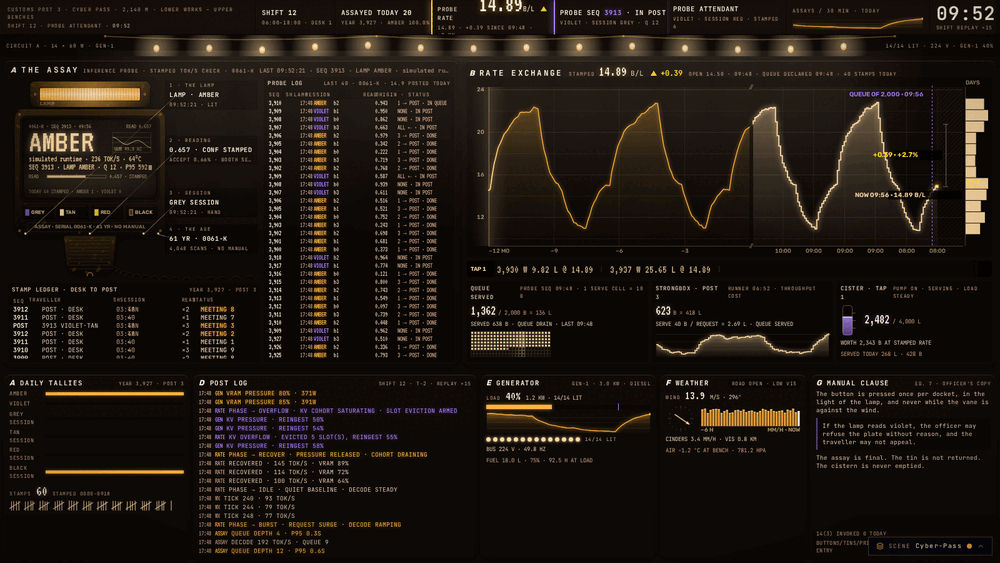
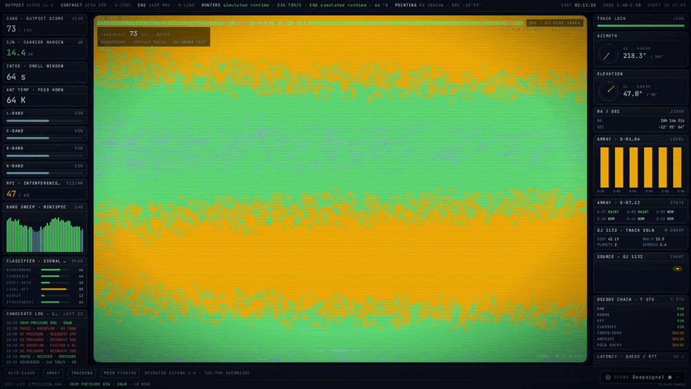
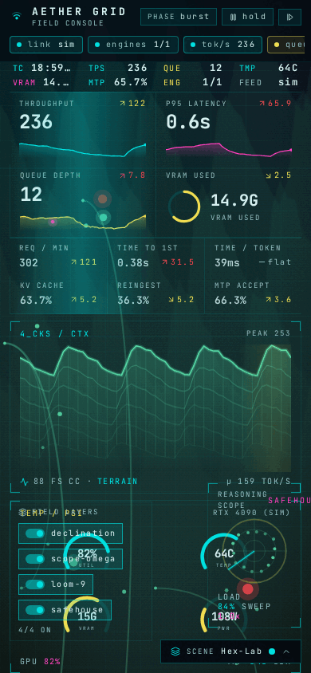
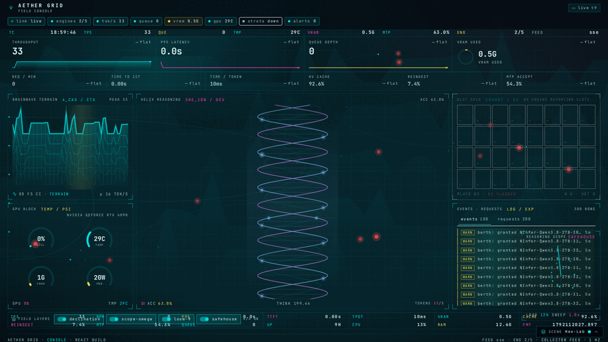

# Aether Grid


Aether Grid watches local inference engines and shows what they are doing, live and from stored history. It reads the GPU, the host, llama-swap, NInfer and Strata, and treats every source as optional, so a missing one leaves its panels empty instead of breaking the page. One process on one port is the whole app, because the collector serves the API and the console build that Vite produces.

## Run

Build the console once, then start the collector.

```sh
npm --prefix web-react install
npm --prefix web-react run build
python3 collector/aether.py [--port 8792] [--config speculum.toml]
```

Open `http://localhost:8792`. The collector exits with a build instruction when `web-react/dist` is missing.

Add `?demo` to the URL for the seeded simulator. `http://localhost:8792/?demo` runs a 60 second story loop over idle, burst, pressure, overflow and recover. It paints through the same path as the live feed and sends no traffic to the collector.

For LAN access, bind all interfaces.

```sh
python3 collector/aether.py --host 0.0.0.0 --port 8792
```

The collector serves `/api/snapshot` and `/api/stream` on that port. The long-range endpoints `/api/history`, `/api/spans`, `/api/leaderboard`, `/api/storage` and `/api/export` read the same SQLite history file.

## Scenes

The console ships five scenes, and each one is a complete visual program over the same telemetry. The registry is `web-react/src/lib/scenes.js`, and the root components map in `web-react/src/App.jsx`. The scene dock, pinned bottom right, switches scene and scheme. The choice persists in `localStorage`, and `?scene=` deep-links a scene.

Every frame below comes from the built console. The five scenes and the phone layout run the demo feed. The last frame is the same console on the live collector feed.

|  |  |
| --- | --- |
| Hex-Lab, the base layout. Native scheme Hex-Lab. | Safehouse, the two-pane SIGINT workstation. Native scheme Corvane. |
|  |  |
| --- | --- |
| Bloom-Line, the orbital greenhouse stage. Native scheme Gullet. | Cyber-Pass, the plate wall under its bulb rail. Native scheme Sounding. |
|  |  |
| --- | --- |
| Deepsignal, the night-watch CRT and its waterfall. Native scheme Hex-Lab. | The phone layout at 390 px, rails hidden. Native scheme Hex-Lab. |



Hex-Lab on the live feed, reading this machine's GPU, host and llama-swap sources.

Each scene keeps its own nouns for the same telemetry. Safehouse reads `SIG model · DECODE tps TOK/S · ENG engine · ON AIR`, Bloom-Line reads `FLOWERED · model · tps TOK/S · MTP mtp% · THINK think`, Cyber-Pass stamps probes with `LAST · SEQ · LAMP · model · tps TOK/S · P95 p95`, and Deepsignal runs a `RUNTIME model · tps TOK/S · ENG engine · tempC` span. Hex-Lab is the base console, with the hero helix, the terrain mesh, the GPU block, the KV cohort, the log and the data band.

## Scene architecture

`SceneRoot` in `web-react/src/scene/SceneRoot.jsx` is the only component that reads the feed and the only owner of a timer. One requestAnimationFrame loop advances `conductor.t` and calls every registered painter. React state changes at feed rate, at most once per second, so the tree does not re-render per frame. When the feed is held or the reader prefers reduced motion, the clock stops and every canvas settles on one static frame of the latest data.

The event bus turns each feed tick into five events. They are `request_arrived`, `token_generated`, `kv_slot_changed`, `vram_pressure` and `anomaly`. Subscribers registered with `conductor.on(type, fn)` receive them, and the canvas painters read the frame trace they leave.

The conductor smooths four scene scalars, `heat`, `alert`, `flow` and `reason`, toward targets from the snapshot. It publishes `heat`, `alert` and `flow` to the document as `--heat`, `--alert` and `--flow`, so CSS chrome and the painters both track scene state from one source.

The Scope primitive (`Scope.jsx`) is a transparent region of the shared surface, drawn with a hairline edge, corner ticks and a caption. A ghosted scope keeps its place in the layout and shows a no-source note when its data source is absent.

Four full-bleed layers sit under and over the scene, toggled from the bottom-left cluster. Declination paints the backdrop wash. Loom-9 routes cables between the engine rail, queue, hero, KV grid and GPU block. Scope-Omega scatters anomaly pings over the whole frame. Safehouse pins a corner radar of load and draws no session content.

## Colour language

Four token roles carry state, and they hold across all seven schemes. The accent token marks healthy activity and token flow. The data token marks heat, which is VRAM, power and temperature. A third token marks reasoning and reingest. One absolute alarm red marks anomaly and pressure, and no scheme overrides it.

## Skins and schemes

Seven schemes ship, and every scene offers all seven. Each scene opens on a native default scheme. A scheme with no table for a scene falls back to the base table in `web-react/src/lib/skins.js`, so every scene and scheme pair resolves to a full palette. The seven are Hex-Lab, Aether, The Braid, IsoDose, Corvane, Sounding and Gullet.

## Adding a scene or a scheme

A new scene needs three registrations. A root component, an entry in `web-react/src/lib/scenes.js`, and an entry in `SCENE_ROOTS` in `web-react/src/App.jsx`.

A scheme supplies tokens only. It adds custom properties in `web-react/src/index.css` and mirrors the canvas channels in `web-react/src/lib/skins.js`. Neither a painter nor a component hard-codes a colour.

## Layout

- `collector/` the feed (`speculum.py`), the engine and host readers, the router and reasoning adapters, and the history store
- `web-react/` the React console, its scene components and painters, and the Vite build in `web-react/dist/`
- `.router/` run folders for staged work
- `docs/` deploy notes, the visual map and the gallery frames

## Dev

In `web-react/`:

```sh
npm run dev
```

The Vite dev server proxies `/api` to a collector on `127.0.0.1:8792`, so start the collector first. Point the browser at the Vite URL for the dev build, or at the collector URL for the built one.

## Tests

Run the collector suite from the repo root.

```sh
python3 -m pytest collector/ -q
```

The last run printed `115 passed, 3 skipped in 8.18s`.

## Sources

Every source is optional, and a missing one leaves its panels empty and its region ghosted.

- GPU through one `nvidia-smi -lms 1000` reader
- Host through `/proc` on Linux or Win32
- llama-swap on `:9090`
- NInfer through its `/running` proxy
- Strata on `:8080`

## Docs

- `docs/DEPLOY.md` covers config, the history database and LAN exposure
- `docs/VISUAL-MAP.md` maps every region to its snapshot source
- `docs/shots/gallery/` holds the frames above
- Repo: https://github.com/T-Crypt/aether-grid
