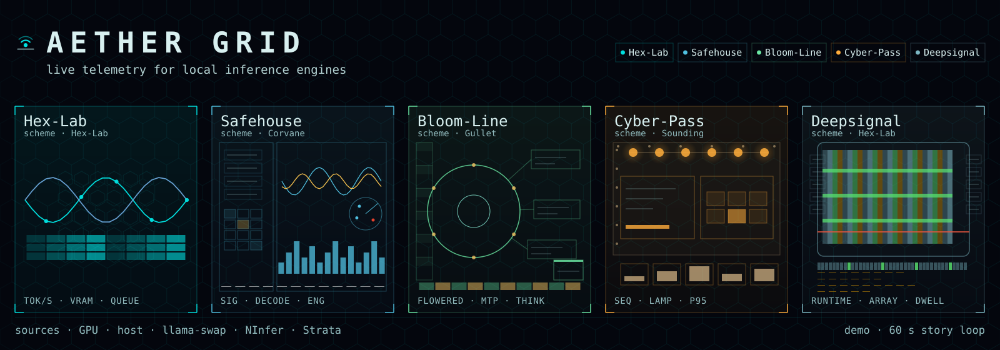

# Aether Grid


Aether Grid watches local inference engines and shows their numbers live, with history. It covers GPU, host, llama-swap, NInfer, and Strata on one screen. Every source is optional. A missing source leaves its panels empty.

The feed is the speculum collector in `collector/` and uses only the standard library. The UI is the React console in `web-react/`. The collector serves the console build and the API together, so one process on one port is the whole app. The default skin is Hex-Lab. Aether and five more stay selectable as skins. Four layers sit on top of the base panels. They are Declination field backdrop, Loom-9 router cables, Scope-Omega anomaly scatter, and Safehouse reasoning scope.

## Scene architecture

The console is one continuous surface, not a grid of cards. Every animated element derives its motion from a single master clock and a shared event bus. One load spike moves the whole scene in the same frame, and a single token advances the helix, a KV slot, the cables and the log together.

The model lives in `web-react/src/scene/`:

- **`SceneRoot` (SceneRoot.jsx)** is the only component that touches the telemetry feed and the only place a timer exists. It owns one **conductor** and publishes `{ t, snap, events, layers, skin, ... }` through context. No other component may run a `setInterval`/`requestAnimationFrame` of its own.
- **The clock.** While the scene is animated, the conductor's one rAF loop advances `conductor.t` and calls every registered painter. Canvases register a paint function via `SceneCanvas` and read the latest snapshot straight off the conductor. React state changes at feed rate only (≤ 1 Hz), so the tree never re-renders per frame. When the feed is held, or the user prefers reduced motion, the clock stops and every canvas settles on one static frame of the latest data.
- **The event bus.** On each feed tick, `translateSnap` diffs consecutive snapshots and emits the five canonical events: `request_arrived`, `token_generated`, `kv_slot_changed`, `vram_pressure`, `anomaly`. Each emit fans out to `conductor.on(type, fn)` subscribers and leaves a frame trace (helix kick, KV slot flashes, scatter pings) that the canvas painters consume. One event produces ripples across the scene in the same frame.
- **Scene state scalars.** The conductor smooths `heat` (VRAM/power/temp), `alert` (anomaly pressure), `flow` (token rate) and `reason` toward targets derived from each snapshot, and publishes them to the document as `--heat` / `--alert` / `--flow`. CSS chrome (KPI rails, warm wash) and the canvas painters both read them, which is how a load burst shifts the palette of the entire scene and back.
- **The Scope primitive (Scope.jsx)** replaces the old card: a transparent region of the shared surface, delineated only by a hairline edge, corner ticks and a caption. `ghosted` keeps a region in layout with a “no source” note when its data source is absent.
- **Full-bleed layers (LayerStack.jsx).** Declination paints a state-reactive backdrop behind everything, Loom-9 routes cables across panel boundaries between the engine rail, queue, hero stage, KV grid and GPU block, Scope-Omega scatters anomaly pings over the whole frame, and Safehouse pins a corner scope. The four switches in the bottom-left cluster still toggle them.

**State colour language** (token-mapped, so it holds across all seven skins): accent token = healthy activity/token flow, data token = heat (VRAM/power/temp), the third token = reasoning/reingest, and one absolute alarm red (`--alm` / `ALM`) = anomaly/pressure that never follows the skin accent.

**For skin authors:** a skin supplies tokens only, the CSS custom properties in `src/index.css` (`--acc`, `--dat`, `--col`, `--alm`, `--pan`, `--bgg`, `--text-*`) and the mirrored RGB channels in `src/lib/skins.js` that the canvas painters read. Never hard-code a colour in a painter or component. Take it from `conductor.palette` or the tokens. The demo (`?demo`) runs a seeded 60 s story loop (idle, burst, VRAM pressure, KV overflow, recover), so any new skin or painter can be watched against a full arc of scene states.

## Layout

- `collector/` speculum feed plus router and reasoning adapters
- `web-react/` the React console (Vite build in `web-react/dist/`)
- `.router/` run folders for staged work
- `docs/` deploy notes and visual map

## Run

Build the console once, then start the collector:

```sh
npm --prefix web-react install
npm --prefix web-react run build
python3 collector/aether.py [--port 8792] [--config speculum.toml]
# serves the console and /api/snapshot + /api/stream on one port:
# http://localhost:8792
```

The collector exits with a build instruction if `web-react/dist` is missing. No backends are needed for a first look. Open `http://localhost:8792/?demo` for the seeded in-browser simulator (same UI, fake data, no collector traffic).

For LAN access bind all interfaces: `python3 collector/aether.py --host 0.0.0.0 --port 8792`.

## Dev

In `web-react/`:

```sh
npm run dev
```

The Vite dev server proxies `/api` to a local collector on `127.0.0.1:8792`, so start the collector first. Point the browser at the Vite URL for the dev build, or at the collector URL for the built one.

See `docs/DEPLOY.md` for config (`speculum.toml`), the history database, and LAN exposure. Visual-to-endpoint mapping is in `docs/VISUAL-MAP.md`.

## Repo

https://github.com/T-Crypt/aether-grid

## Sources

All optional. Each degrades to no data. GPU via one `nvidia-smi -lms 1000` reader. Host via `/proc` or Win32. llama-swap `:9090`. NInfer backend via `/running` proxy. Strata `:8080`.
